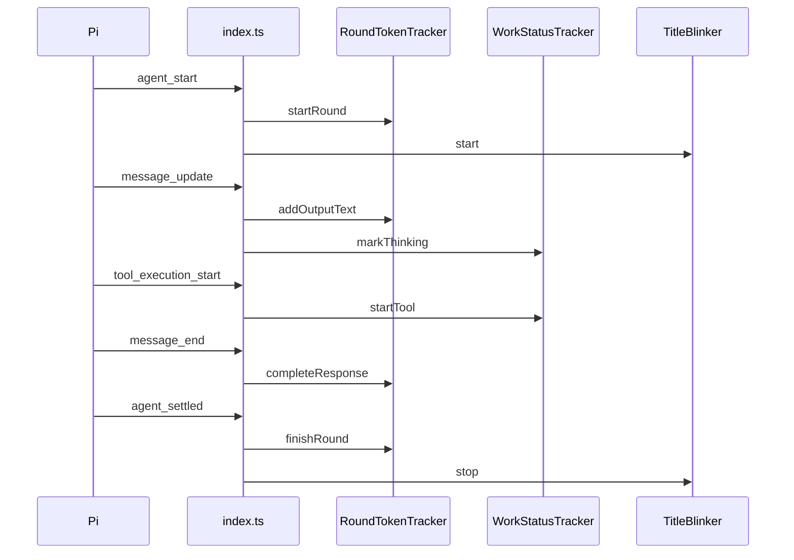

# Detailed Technical Design: Pi Extension "Claude Code Look"

This document tells an implementer exactly how to build the extension. The reasons and the user-visible behavior are in the [specification](../specification.md).

<a id="table-of-contents"></a>
## Table of Contents

- [Document Control](#document-control)
- [Technical Scope](#technical-scope)
- [Architecture and Execution Context](#architecture-and-execution-context)
- [Technology Stack](#technology-stack)
- [Dependency Inventory](#dependency-inventory)
- [Repository Structure](#repository-structure)
- [Configuration and Secret Design](#configuration-and-secret-design)
- [Module Design](#module-design)
- [File-Level, Class, and Function Design](#file-level-class-and-function-design)
  - [src/token-tracker.ts](#srctoken-trackerts)
  - [src/work-status.ts](#srcwork-statusts)
  - [src/title-blinker.ts](#srctitle-blinkerts)
  - [src/index.ts](#srcindexts)
- [Data Model Design](#data-model-design)
- [Internal Interface Design](#internal-interface-design)
- [External API Reference: Pi Extension API](#external-api-reference-pi-extension-api)
  - [Events Consumed](#events-consumed)
  - [Interface Calls Made](#interface-calls-made)
  - [Verified Host Behavior](#verified-host-behavior)
- [APIs Implemented by the Project](#apis-implemented-by-the-project)
- [Runtime and Data Flow](#runtime-and-data-flow)
- [Error Handling and Resilience](#error-handling-and-resilience)
- [Logging, Metrics, and Observability](#logging-metrics-and-observability)
- [Security Design](#security-design)
- [Testing Design](#testing-design)
- [Build, Run, and Deployment Design](#build-run-and-deployment-design)
- [Implementation Roadmap](#implementation-roadmap)
- [Implementation Instructions for Coding Agent](#implementation-instructions-for-coding-agent)

## Document Control

| Field | Value |
|---|---|
| Subsystem | Pi extension `pi-extension-claude-code` |
| Status | Implementation-ready |
| Delivery mode | Standard |
| Specification | `outputs/pi_extension_claude_code/specification.md` |
| DTD path | `outputs/pi_extension_claude_code/docs/DTD.md` |
| Last updated | 2026-11-04 |
| Open decisions | None |

[↑ Back to Table of Contents](#table-of-contents)

## Technical Scope

**In scope:** the green-circle working row, the per-round token line, and the blinking title, in Pi's interactive terminal mode (`ctx.mode === "tui"`).

**Out of scope:** transcript restyling, retry and compaction row restyling, user `!` commands, and user configuration. The extension has no settings because the requirements fix every value.

**Runtime constraints:** Pi 1.4.0 loads the extension through `jiti`, on Node.js 24 on Windows 11. The source MUST also run under Node's built-in type stripping, so that the unit tests need no build step. Therefore the source uses only erasable TypeScript syntax: no `enum`, no parameter properties, and explicit `.ts` extensions on relative imports.

[↑ Back to Table of Contents](#table-of-contents)

## Architecture and Execution Context

The extension runs inside the Pi process and has one thread, like all Pi extensions. `src/index.ts` is the only file that touches Pi. It imports the three state classes; the state classes import nothing from the project or from Pi at runtime.



The diagram shows one round. Pi can send `agent_start` several times inside a round, for example after a retry. Only the first one after a settled state starts a round.

[↑ Back to Table of Contents](#table-of-contents)

## Technology Stack

| Technology | Version | Role | Reason |
|---|---|---|---|
| Pi (`@earendil-works/pi-coding-agent`) | 1.4.0 installed; peer range `*` | Host and type declarations | The Pi package guide requires host packages to be `peerDependencies` with range `*`. |
| TypeScript | ^5.9 (development only) | Type checks | Pi runs TypeScript directly, so no compile output is produced. |
| `node:test` | Node.js 24 built-in | Unit tests | No extra test framework is needed. |
| `@lydell/node-pty` | 1.2.0-beta.18 (development only) | Runs real Pi in a pseudo-terminal for the end-to-end test | It ships prebuilt Windows binaries, so no compiler is required. |
| `@xterm/headless` | ^5.5 (development only) | Rebuilds the terminal screen from the captured bytes | The test can then assert what is on the bottom line. |

[↑ Back to Table of Contents](#table-of-contents)

## Dependency Inventory

Runtime code imports only these items:

```text
Library/module: @earendil-works/pi-coding-agent
Version/constraint: peer "*", verified against 1.4.0
Type: runtime host (type-only imports, erased at load time)
Imported symbols: ExtensionAPI, ExtensionContext
Used by: src/index.ts
Lifecycle: Pi calls the default export once per extension runtime
Failure modes: Pi reports handler errors and continues

Library/module: node:path
Type: standard library
Imported symbols: basename
Used by: src/title-blinker.ts (formatBaseTitle)
```

The end-to-end test additionally uses `spawn` from `@lydell/node-pty`, `Terminal` from `@xterm/headless`, and `createAssistantMessageEventStream` from `@earendil-works/pi-ai`, which Pi provides to extensions.

[↑ Back to Table of Contents](#table-of-contents)

## Repository Structure

```text
outputs/pi_extension_claude_code/
├── .gitignore
├── package.json
├── tsconfig.json
├── README.md
├── specification.md
├── docs/DTD.md
├── docs/modules/claude-code-look.md
├── src/index.ts
├── src/token-tracker.ts
├── src/work-status.ts
├── src/title-blinker.ts
├── tests/token-tracker.test.ts
├── tests/work-status.test.ts
├── tests/title-blinker.test.ts
├── tests/index.test.ts
├── tests/e2e/fake-provider.ts
└── tests/e2e/run-tui-smoke.ts
```

The Git repository root is `outputs/pi_extension_claude_code/`. The workspace-level `.git` folder is empty and is not a repository, and the workspace contains many unrelated projects, so the extension keeps its own history.

[↑ Back to Table of Contents](#table-of-contents)

## Configuration and Secret Design

Not applicable. The extension reads no environment variable, settings file, or credential. The values below are constants in the source.

| Constant | Value | File | Purpose |
|---|---|---|---|
| `BLINK_INTERVAL_MS` | 500 | `title-blinker.ts` | Time between title changes. |
| `STATUS_REFRESH_MS` | 200 | `index.ts` | Time between refreshes of the bottom line. |
| `STATUS_KEY` | `"0-claude-code-tokens"` | `index.ts` | Status key that sorts before other extensions' keys. |
| `WORKING_INDICATOR_FRAME` | `"🟢"` | `index.ts` | The single static frame of the working row. |
| `MAX_DETAIL_LENGTH` | 72 | `work-status.ts` | Longest label, in code points. |

[↑ Back to Table of Contents](#table-of-contents)

## Module Design

The project has one module, `src/`, described in [docs/modules/claude-code-look.md](modules/claude-code-look.md). The allowed import direction is `index.ts` → `token-tracker.ts`, `work-status.ts`, `title-blinker.ts`. The three state files MUST NOT import each other, and MUST NOT import Pi. The error boundary is the `safelyUpdateUi` wrapper in `index.ts`.

[↑ Back to Table of Contents](#table-of-contents)

## File-Level, Class, and Function Design

Each subsection lists the exported symbols of one source file and the rules they must obey.

[↑ Back to Table of Contents](#table-of-contents)

### src/token-tracker.ts

**`estimateTextTokens(text: string): number`** returns a possibly fractional estimate. Each code point in the CJK, kana, Hangul, or CJK-punctuation ranges counts as 1 token. Every other code point counts as 0.25 tokens.

**`class RoundTokenTracker`** has no constructor arguments. It holds the totals of completed responses, the state of the open response, the start and finish times, and whether a round is active.

| Method | Behavior |
|---|---|
| `startRound(nowMs: number): void` | Clears every total and the open response, stores the start time, and marks the round active. |
| `isRoundActive(): boolean` | Returns whether a round is active. |
| `beginResponse(estimatedInputTokens: number \| null): void` | Discards any open response state and opens a new one with this input estimate. |
| `addOutputText(text: string): void` | Adds `estimateTextTokens(text)` to the open output estimate. |
| `applyPartialUsage(usage: TokenUsage): void` | Stores the provider's newest usage for the open response. |
| `completeResponse(usage: TokenUsage): void` | Moves the open response into the totals, using the rule below, and closes it. |
| `finishRound(nowMs: number): void` | Moves any open response into the totals with zero usage, stores the finish time, and marks the round inactive. |
| `readSnapshot(nowMs: number): RoundSnapshot \| null` | Returns totals plus the open response, or `null` when no round has started. |

**Rule for mixing exact and estimated numbers.** For each direction, a reported value greater than zero is exact. Otherwise the extension uses the estimate and flags that direction as estimated. While a response is open, the output figure is `max(reported output, estimated output)`, because some providers report a tiny placeholder output count at the start of a stream. When a response completes, a reported output greater than zero replaces the estimate.

**Rule for failed requests.** `completeResponse` discards a response that has no reported usage and no estimated output. Such a request failed before the model produced anything, so its input estimate must not count as consumption.

**`formatTokenCount(count: number): string`** returns `"950"`, `"1.2k"`, or `"3.40M"`. **`formatElapsed(ms: number): string`** returns `"12s"` or `"1m 05s"`. **`formatRoundStatus(snapshot: RoundSnapshot): string`** returns the line shown in the specification.

[↑ Back to Table of Contents](#table-of-contents)

### src/work-status.ts

**`sanitizeDetail(text: string, maxLength: number): string`** removes ANSI escape sequences, replaces each control character with a space, collapses runs of whitespace, trims the result, and shortens it to `maxLength` code points with a final `…`.

**`describeToolWork(toolName: string, args: unknown): string`** maps a tool call to a label, using the argument names verified in Pi 1.4.0:

| Tool | Argument | Label | Fallback without argument |
|---|---|---|---|
| `bash` | `command` | `Running <command>` | `Running a command` |
| `read` | `path` | `Reading <path>` | `Reading a file` |
| `edit` | `path` | `Editing <path>` | `Editing a file` |
| `write` | `path` | `Writing <path>` | `Writing a file` |
| `grep` | `pattern` | `Searching for <pattern>` | `Searching files` |
| `find` | `pattern` | `Finding <pattern>` | `Finding files` |
| `ls` | `path` | `Listing <path>` | `Listing files` |
| other | none | `Using <toolName>` | none |

**`class WorkStatusTracker`** has no constructor arguments. It holds the current model phase label and an insertion-ordered `Map` from `toolCallId` to label.

| Method | Behavior |
|---|---|
| `reset(): void` | Sets the phase to `Thinking…` and clears the running tools. |
| `markThinking(): void` | Sets the phase to `Thinking…`. |
| `markWriting(): void` | Sets the phase to `Writing response…`. |
| `markPreparingTool(): void` | Sets the phase to `Preparing tool call…`. |
| `startTool(toolCallId: string, toolName: string, args: unknown): void` | Records the label of a running tool. |
| `endTool(toolCallId: string): void` | Removes a running tool. An unknown id has no effect. |
| `readLabel(): string` | Returns the newest tool label, with ` (+N more)` when N other tools run. Without running tools it returns the phase. The result is sanitized and limited to `MAX_DETAIL_LENGTH`. |

The ` (+N more)` suffix MUST stay visible, so `readLabel` shortens the tool label before it adds the suffix.

[↑ Back to Table of Contents](#table-of-contents)

### src/title-blinker.ts

**`formatBaseTitle(cwd: string, sessionName: string | undefined): string`** returns `π - <session> - <basename>` or `π - <basename>`. This is the same format as `updateTerminalTitle` in Pi's `interactive-mode.js`.

**`class TitleBlinker`** has the constructor `constructor(setTitle: (title: string) => void, readBaseTitle: () => string)`.

| Method | Behavior |
|---|---|
| `start(): void` | Does nothing when already running. Otherwise it writes `🟢 <base>` at once, starts a 500-millisecond interval that alternates `🔴` and `🟢`, and calls `unref()` on the timer. |
| `stop(): void` | Does nothing when not running. Otherwise it clears the interval and writes `<base>`. |

The class reads the base title on every tick, so a session rename during a round appears on the next tick.

[↑ Back to Table of Contents](#table-of-contents)

### src/index.ts

**`default export function installClaudeCodeLook(pi: ExtensionAPI): void`** creates one instance of each class, and registers one handler for each event in [Events Consumed](#events-consumed). The factory MUST NOT start a timer, because Pi also loads extensions when no session will start.

The file holds these local helpers:

- `isTerminalUi(ctx)` returns `ctx.mode === "tui"`. Every handler returns at once when this is false.
- `safelyUpdateUi(action)` runs a UI write inside `try`/`catch` and ignores errors, because an old session context can throw after a session is replaced.
- `publishWorkLabel(ctx)` calls `setWorkingMessage` when the label differs from the last label written.
- `publishTokenStatus(ctx)` calls `setStatus` when the text differs from the last text written.
- `beginRound(ctx)` starts the tracker, the blinker, and the status timer.
- `endRound(ctx)` finishes the tracker, stops the blinker and the status timer, restores the default working message, and writes the final status.

The status timer calls `publishTokenStatus` every `STATUS_REFRESH_MS`, and `unref()` is called on it. Streaming handlers MUST NOT call `setStatus` directly, so that a fast stream cannot cause extra redraws.

[↑ Back to Table of Contents](#table-of-contents)

## Data Model Design

The extension stores nothing on disk. Two in-memory shapes cross a function boundary:

```typescript
/** The token fields the extension reads from Pi's `Usage` type. All are non-negative counts. */
interface TokenUsage {
  input: number;      // uncached input tokens
  output: number;     // output tokens, including reasoning
  cacheRead: number;  // input tokens served from the cache
  cacheWrite: number; // input tokens written to the cache
}

/** The display figures of one round. */
interface RoundSnapshot {
  isActive: boolean;           // true until the round settles
  inputTokens: number;         // input + cacheRead + cacheWrite, whole number
  cachedInputTokens: number;   // sum of cacheRead, whole number
  outputTokens: number;        // whole number
  isInputEstimated: boolean;   // true when any part of inputTokens is an estimate
  isOutputEstimated: boolean;  // true when any part of outputTokens is an estimate
  elapsedMs: number;           // time since the round started, frozen at finish
}
```

[↑ Back to Table of Contents](#table-of-contents)

## Internal Interface Design

All calls are synchronous, take plain values, and transfer no ownership. `index.ts` is always the caller. The method tables above define each input and output. The only callbacks are the two functions given to the `TitleBlinker` constructor. They close over a variable in `index.ts` that holds the newest `ExtensionContext`, and `session_shutdown` stops the timer before that context becomes invalid.

[↑ Back to Table of Contents](#table-of-contents)

## External API Reference: Pi Extension API

Provider: Pi. API version: `@earendil-works/pi-coding-agent` 1.4.0. Sources: `docs/extensions.md`, `dist/core/extensions/types.d.ts`, and `dist/modes/interactive/interactive-mode.js` in the installed package. Last verified: 2026-11-04. The API is in-process, so HTTP fields, authentication, retries, and rate limits do not apply.

[↑ Back to Table of Contents](#table-of-contents)

### Events Consumed

| Event | Payload fields read | Handler action |
|---|---|---|
| `session_start` | none | Calls `setWorkingIndicator({ frames: ["🟢"] })`. |
| `agent_start` | none | Calls `beginRound` when no round is active, then publishes the label. |
| `turn_start` | none | Calls `markThinking` and publishes the label. |
| `message_start` | `message.role` | For `assistant`, calls `beginResponse(ctx.getContextUsage()?.tokens ?? null)`. |
| `message_update` | `assistantMessageEvent.type`, `.delta`, `.partial.usage` | Updates the phase, the output estimate, and the partial usage. |
| `message_end` | `message.role`, `message.usage` | For `assistant`, calls `completeResponse(message.usage)` and `markThinking`. |
| `tool_execution_start` | `toolCallId`, `toolName`, `args` | Calls `startTool` and publishes the label. |
| `tool_execution_end` | `toolCallId` | Calls `endTool` and publishes the label. |
| `agent_settled` | none | Calls `endRound`. |
| `session_shutdown` | none | Stops the status timer and the blinker. |

The `message_update` phase mapping is: `thinking_start` and `thinking_delta` call `markThinking`; `text_start` and `text_delta` call `markWriting`; `toolcall_start` and `toolcall_delta` call `markPreparingTool`. The three `*_delta` types also call `addOutputText(delta)`.

[↑ Back to Table of Contents](#table-of-contents)

### Interface Calls Made

| Call | Purpose | Note |
|---|---|---|
| `ctx.ui.setWorkingIndicator({ frames: ["🟢"] })` | Replaces the spinner. | A single frame is static, and custom frames render verbatim, so the color comes from the emoji itself. |
| `ctx.ui.setWorkingMessage(label?)` | Sets the row text. | Calling it with no argument restores the default text. |
| `ctx.ui.setStatus(key, text)` | Writes the bottom line. | Pi sorts statuses by key, joins them with a space, and truncates them to the terminal width. |
| `ctx.ui.theme.fg("muted", text)` | Colors the bottom line. | Follows the person's Pi theme, such as `jirai-kei-trans-pride`. |
| `ctx.ui.setTitle(title)` | Writes the terminal title. | Pi forwards it to `terminal.setTitle`. |
| `ctx.getContextUsage()` | Estimates the input tokens of a request. | `tokens` can be `null` right after compaction. |
| `pi.getSessionName()` | Supplies the title's session name. | May be `undefined`. |

[↑ Back to Table of Contents](#table-of-contents)

### Verified Host Behavior

- Pi hides the working row at `agent_end` and shows it again at `turn_start`, reusing the stored working message. Therefore the row survives a retry.
- `agent_end` is not the final idle signal, because retries and compaction can follow. `agent_settled` is the only event that ends a round.
- `agent_settled` also fires after an abort, with `aborted: true`.
- Pi clears statuses, working messages, and indicators when the extension runtime is replaced. Therefore `session_start` must set the indicator again, and a new session starts with no token line.
- `setWorkingMessage` and `setWorkingIndicator` are no-ops in RPC mode, while `setStatus` and `setTitle` emit RPC messages. This is why the `isTerminalUi` guard is required.
- The title is overwritten by Pi when a session is renamed. The next blink tick repairs it during a round.

[↑ Back to Table of Contents](#table-of-contents)

## APIs Implemented by the Project

Not applicable. The extension registers no tools, commands, or network endpoints. Its only contract is the default export that Pi calls, and the manifest entry `"pi": { "extensions": ["./src/index.ts"] }`.

[↑ Back to Table of Contents](#table-of-contents)

## Runtime and Data Flow

A typical round proceeds in this order:

1. The person submits a prompt. Pi fires `agent_start`. The extension starts the round, writes `🟢 π - <folder>` to the title, and sets the row to `Thinking…`.
2. The first streamed event fires `message_start`. The extension opens a response with Pi's context estimate as the input figure.
3. Each `message_update` adds to the output estimate and updates the phase. The 200-millisecond timer writes the changed line to the bottom of the screen.
4. `message_end` replaces the estimates with the provider's exact usage.
5. When the response requests a tool, `tool_execution_start` changes the row to, for example, `Running git status`. `tool_execution_end` returns it to `Thinking…`. The next turn repeats from step 2, and its tokens add to the round totals.
6. Pi fires `agent_settled` after its last automatic step. The extension writes the `Last round:` line, restores the normal title, and stops both timers.

**Failure branches:** after a provider error with an automatic retry, `agent_start` fires again without a new round, and the failed request adds nothing if it produced nothing. After an abort with the Escape key, the partial response keeps its estimate, and the `~` mark stays visible.

[↑ Back to Table of Contents](#table-of-contents)

## Error Handling and Resilience

The extension defines no error types and performs no retries. `safelyUpdateUi` ignores UI errors, because a status display must never disturb the agent. Pi also catches and reports any other handler error. Missing or malformed tool arguments fall back to the labels in the table, because `describeToolWork` checks that each argument is a non-empty string. A missing `usage` on a partial message is skipped. `stop` and `endRound` are idempotent, because abort, reload, and shutdown can converge on them.

[↑ Back to Table of Contents](#table-of-contents)

## Logging, Metrics, and Observability

The extension writes no logs, because writing to the terminal would corrupt Pi's screen. The token line is its only output.

[↑ Back to Table of Contents](#table-of-contents)

## Security Design

The extension reads tool arguments and displays them in the working row. Pi already shows these arguments in the transcript, so no new exposure arises inside the terminal. Two rules prevent new risks:

- `sanitizeDetail` removes escape sequences and control characters, so that a crafted command or file name cannot inject terminal control codes.
- The title never contains tool arguments, because window titles are visible to other programs and in screen sharing.

[↑ Back to Table of Contents](#table-of-contents)

## Testing Design

Unit tests use `node:test` and run without Pi:

| Target | Scenarios |
|---|---|
| `RoundTokenTracker` | Estimates for Latin and CJK text; live figures during a stream; exact usage replaces estimates; tokens add across responses; `startRound` resets; a failed empty response is discarded; an aborted response stays estimated. |
| Formatters | Thresholds of `formatTokenCount` and `formatElapsed`; the `~` mark and the cached part of `formatRoundStatus`. |
| `WorkStatusTracker` | Every tool label; fallbacks for bad arguments; parallel tools; sanitizing of ANSI codes and line breaks; truncation that keeps the suffix. |
| `TitleBlinker` | Alternation with mocked timers; restored title; idempotent start and stop. |
| `index.ts` | With a fake `pi` and `ctx`: full round wiring; multiple `agent_start` events; no UI calls outside TUI mode; UI errors are ignored. |

The end-to-end test `tests/e2e/run-tui-smoke.ts` starts the real installed Pi in a pseudo-terminal with a temporary configuration directory, so it never reads real credentials or contacts a real model. `tests/e2e/fake-provider.ts` registers a scripted model that reasons, requests `bash` and `read`, and then answers with slow streaming and exact usage. The test sends two prompts and asserts each [acceptance criterion](../specification.md#acceptance-criteria) on the captured title sequences and on the rebuilt screen, including that the token text is on the last non-empty line.

[↑ Back to Table of Contents](#table-of-contents)

## Build, Run, and Deployment Design

There is no build step. The commands, run from the project directory, are:

```powershell
npm install        # development tools only
npm run typecheck  # tsc --noEmit
npm test           # unit tests
npm run test:e2e   # real Pi terminal test
pi -e ./src/index.ts       # try the extension once
pi install ./              # keep it enabled; this writes to ~/.pi/agent/settings.json
```

[↑ Back to Table of Contents](#table-of-contents)

## Implementation Roadmap

**Step 1 — State classes.** Prerequisites: the project skeleton. Create `src/token-tracker.ts`, `src/work-status.ts`, and `src/title-blinker.ts`, together with their test files, as specified above. Verification: `npm test`. Acceptance: all unit tests pass, and no state file imports Pi.

**Step 2 — Pi wiring.** Prerequisites: Step 1. Create `src/index.ts` and `tests/index.test.ts`. Verification: `npm run typecheck` and `npm test`. Acceptance: the wiring tests pass, and the code type-checks against the real Pi declarations.

**Step 3 — End-to-end check.** Prerequisites: Step 2. Create the two files in `tests/e2e/`. Verification: `npm run test:e2e`. Acceptance: every acceptance criterion passes against real Pi.

**Step 4 — Paperwork.** Prerequisites: Step 3. Write `README.md` and the module note, and reconcile this DTD and the specification with the code. Verification: check the table-of-contents links. Acceptance: the documents match the delivered code.

[↑ Back to Table of Contents](#table-of-contents)

## Implementation Instructions for Coding Agent

1. Implement the roadmap steps in order, and do not skip prerequisites.
2. Treat this DTD as the implementation contract. Do not silently replace its dependencies, events, schemas, module boundaries, or algorithms.
3. Do not invent architecture that this DTD omits when a material decision is required.
4. Run the listed verification after each step, and update tests together with the code.
5. Preserve the dependency direction described in [Module Design](#module-design).
6. Report contradictions, unavailable APIs, and unmet criteria. When implementation evidence proves this DTD wrong, update it before continuing.
7. Keep deferred work deferred unless Fides expands the scope, and preserve unrelated repository changes.

[↑ Back to Table of Contents](#table-of-contents)
