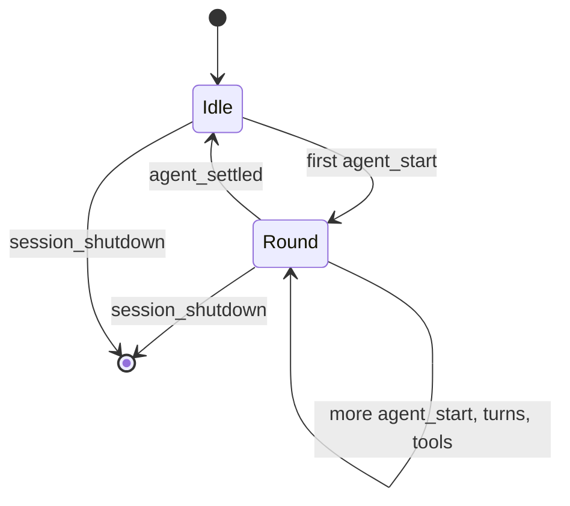

# Module Note: claude-code-look (`src/`)

## Table of Contents

- [Purpose](#purpose)
- [Project Position](#project-position)
- [Inputs and Outputs](#inputs-and-outputs)
- [Dependencies and Dependents](#dependencies-and-dependents)
- [Control Flow](#control-flow)
- [Key Decisions and Limits](#key-decisions-and-limits)
- [Relevant Verification](#relevant-verification)

## Purpose

This module shows Pi's live work in the style of Claude Code. It exists because Pi's default display shows a generic spinner and session-wide totals, while Fides wants to see the current activity and the cost of the current round.

[↑ Back to Table of Contents](#table-of-contents)

## Project Position

The module is the whole extension. Pi loads `src/index.ts` through the `pi.extensions` entry in `package.json`.

[↑ Back to Table of Contents](#table-of-contents)

## Inputs and Outputs

The module receives Pi lifecycle events and calls `ctx.getContextUsage()` and `pi.getSessionName()`. It writes to three places: the working row, the extension status line at the bottom of the screen, and the terminal title. It stores nothing on disk, and it registers no tools or commands.

[↑ Back to Table of Contents](#table-of-contents)

## Dependencies and Dependents

`index.ts` imports `work-status.ts`, `token-tracker.ts`, and `title-blinker.ts`. Those three files do not import each other or Pi. The only runtime imports are Pi's types, which disappear at load time, and `node:path`. Nothing in the project depends on this module except its tests.

[↑ Back to Table of Contents](#table-of-contents)

## Control Flow

The first `agent_start` after an idle state begins a round, and `agent_settled` ends it. Between them, streaming events only change counters and labels in memory. A 200-millisecond timer copies the token text to the screen when it has changed, and a 500-millisecond timer alternates the title.

[↑ Back to Table of Contents](#table-of-contents)

## Key Decisions and Limits

- **`agent_settled` ends a round, not `agent_end`.** Pi can retry or compact after `agent_end`, so that event does not mean Pi is idle.
- **The token line uses `setStatus`, not a replaced footer.** A status line keeps Pi's footer and other extensions' statuses intact, and it is the bottom screen row. The status key sorts first, so a long status from another extension cannot hide the count.
- **Estimates are shown until exact numbers arrive.** Many providers report usage only at the end of a response, so an exact-only count would not be live. Each estimated figure carries a `~`.
- **CJK text uses a separate estimate.** Fides often works in Chinese and Japanese, and the common four-characters-per-token rule would badly undercount that text.
- **The title never contains tool arguments**, because window titles are visible outside the terminal.
- **Tool arguments are sanitized**, because the model controls them and control codes could disturb the terminal.
- **Limit:** Pi draws its retry and compaction rows itself, so they keep the normal spinner.
- **Limit:** Pi does not expose its title text, so the module rebuilds Pi 1.4.0's format.

[↑ Back to Table of Contents](#table-of-contents)

## Relevant Verification

`npm run typecheck`, `npm test` for the unit tests in `tests/`, and `npm run test:e2e` for the real Pi terminal test in `tests/e2e/`.

[↑ Back to Table of Contents](#table-of-contents)
