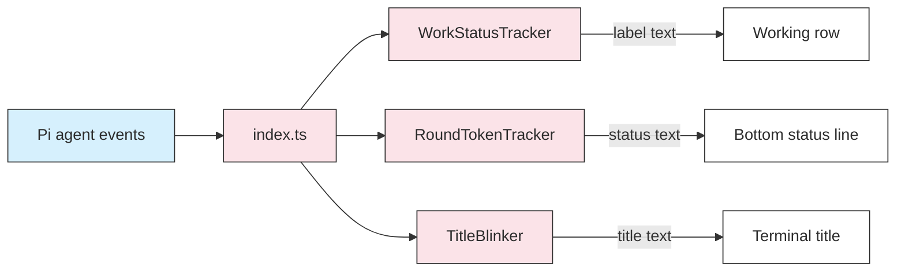

# Pi Extension: Claude Code Look — Specification

This document explains what the extension does for the person using Pi and why it is designed this way. The implementation contract lives in [docs/DTD.md](docs/DTD.md).

<a id="table-of-contents"></a>
## Table of Contents

- [Project Description](#project-description)
- [Project Structure](#project-structure)
- [Functional Requirements](#functional-requirements)
  - [FR-1 Green Circle on the Working Row](#fr-1-green-circle-on-the-working-row)
  - [FR-2 Live Token Consumption for the Current Round](#fr-2-live-token-consumption-for-the-current-round)
  - [FR-3 Blinking Terminal Title](#fr-3-blinking-terminal-title)
- [Non-Functional Requirements](#non-functional-requirements)
- [Non-Goals and Deferred Work](#non-goals-and-deferred-work)
- [Data Flow and Dependencies](#data-flow-and-dependencies)
- [Class Descriptions](#class-descriptions)
- [Assumptions and Risks](#assumptions-and-risks)
- [Acceptance Criteria](#acceptance-criteria)

## Project Description

Pi is a terminal coding agent. This extension makes Pi's live status feel like Claude Code. While Pi works, the person sees what Pi is doing, how many tokens the current request has used so far, and a blinking terminal title that is visible from another window or tab.

The extension only changes how Pi displays its status. It does not change prompts, tools, model requests, or stored sessions.

[↑ Back to Table of Contents](#table-of-contents)

## Project Structure

```text
outputs/pi_extension_claude_code/
├── package.json            Pi package manifest and development scripts
├── tsconfig.json           Type-check settings
├── README.md               User manual
├── specification.md        This document
├── docs/
│   ├── DTD.md              Implementation contract
│   └── modules/
│       └── claude-code-look.md   Module design note
├── src/
│   ├── index.ts            Connects Pi events to the three classes
│   ├── work-status.ts      Decides the text of the working row
│   ├── token-tracker.ts    Counts and formats the tokens of a round
│   └── title-blinker.ts    Alternates the terminal title
└── tests/
    ├── *.test.ts           Unit tests
    └── e2e/                Real Pi terminal test with a fake model
```

[↑ Back to Table of Contents](#table-of-contents)

## Functional Requirements

This section describes the behavior a person sees in the terminal.

[↑ Back to Table of Contents](#table-of-contents)

### FR-1 Green Circle on the Working Row

While Pi works, the working row above the editor MUST show `🟢 <detail>`. The circle replaces Pi's default spinner. The detail changes with the work:

| What Pi is doing | Example of the row |
|---|---|
| Waiting for the model, or receiving its reasoning | `🟢 Thinking…` |
| Receiving the answer text | `🟢 Writing response…` |
| Receiving a tool request from the model | `🟢 Preparing tool call…` |
| Running a terminal command | `🟢 Running git status` |
| Reading a file | `🟢 Reading src/index.ts` |
| Changing a file | `🟢 Editing src/index.ts` or `🟢 Writing README.md` |
| Searching or listing | `🟢 Searching for TODO`, `🟢 Finding *.ts`, `🟢 Listing src` |
| Using any other tool | `🟢 Using mcp__docs__search` |
| Running several tools at once | `🟢 Reading a.ts (+2 more)` |

The extension MUST remove line breaks and terminal control characters from the detail, and MUST shorten a long detail so that the row stays readable.

[↑ Back to Table of Contents](#table-of-contents)

### FR-2 Live Token Consumption for the Current Round

The bottom line of the Pi screen MUST show the token use of the current **round**. One round starts when Pi begins working on a prompt and ends when Pi has no automatic work left. A round may contain many model requests, because each tool result leads to another request. The count resets when the next round starts.

The line looks like this during and after a round:

```text
This round: ↑ ~45.2k ↓ ~1.3k tokens · 12s
Last round: ↑ 45.1k (40.0k cached) ↓ 1.4k tokens · 18s
```

- `↑` is the total input tokens of every model request in the round, including cached input.
- `↓` is the total output tokens of every model request in the round.
- `~` marks an estimate. Many model providers report exact usage only when a response ends. The extension therefore estimates tokens from the streamed text and replaces the estimate with the exact number as soon as the provider reports it.
- The final figure of a round stays visible until the next round starts.

Pi's own footer keeps showing the session totals. The new line does not replace it.

[↑ Back to Table of Contents](#table-of-contents)

### FR-3 Blinking Terminal Title

While Pi works, the terminal title MUST alternate between `🟢 π - <folder>` and `🔴 π - <folder>` every 500 milliseconds. When Pi has finished, the title MUST return to Pi's normal text, `π - <folder>`, or `π - <session name> - <folder>` when the session has a name.

The title never contains command text, so that a secret inside a command cannot appear in the window list.

[↑ Back to Table of Contents](#table-of-contents)

## Non-Functional Requirements

- **Compatibility.** The extension targets Pi 1.4.0 and uses only the public extension API.
- **Other modes.** The extension MUST do nothing in `print`, `json`, and `rpc` modes, so that it adds no output to scripts.
- **No side effects on the agent.** A failure inside the extension MUST NOT block a tool or a model request.
- **Performance.** Streaming events only update counters in memory. The bottom line refreshes at most five times per second.
- **Clean shutdown.** All timers stop when a round ends or a session is replaced. No timer keeps the Pi process alive.
- **Dependencies.** The extension has no runtime dependency other than Pi itself.

[↑ Back to Table of Contents](#table-of-contents)

## Non-Goals and Deferred Work

- The extension does not imitate the rest of the Claude Code interface, such as its transcript bullets or its welcome screen. These may be added later if Fides requests them.
- The extension does not change Pi's own status rows for automatic retry and context compaction, because Pi draws those rows separately. The circle does not appear on them, but the title keeps blinking and the token line keeps updating.
- A command that the person starts with `!` is not agent work, so it does not start a round.
- A follow-up message queued while Pi is working counts as part of the running round, because Pi does not stop between them.

[↑ Back to Table of Contents](#table-of-contents)

## Data Flow and Dependencies

Pi sends lifecycle events to `src/index.ts`. The entry file gives each event to the class that owns the matching state, and then writes the results to the Pi interface. Dependencies point in one direction: the three classes do not know about Pi or about each other, which allows the unit tests to run without Pi.



[↑ Back to Table of Contents](#table-of-contents)

## Class Descriptions

| Class | File | Responsibility |
|---|---|---|
| `WorkStatusTracker` | `src/work-status.ts` | Remembers the current model phase and the running tools, and produces the text of the working row. |
| `RoundTokenTracker` | `src/token-tracker.ts` | Adds up exact and estimated tokens for one round, and returns a snapshot for display. |
| `TitleBlinker` | `src/title-blinker.ts` | Owns the 500-millisecond timer that alternates the title, and restores the normal title when stopped. |

[↑ Back to Table of Contents](#table-of-contents)

## Assumptions and Risks

- **Estimates can differ from exact counts.** The estimator counts one token per Chinese, Japanese, or Korean character and one token per four other characters. Exact provider numbers replace the estimates when available.
- **Terminal support.** Windows Terminal shows emoji in the title. The legacy Windows console host may show a placeholder box instead.
- **Normal title format.** Pi does not expose its title text to extensions, so the extension rebuilds the same format. A future Pi version could change that format.
- **Status order.** Pi sorts extension statuses by key and joins them on one line. The extension uses a key that sorts first, so that a long status from another extension cannot push the token count off the screen.

[↑ Back to Table of Contents](#table-of-contents)

## Acceptance Criteria

1. A real Pi terminal session shows `🟢 Running <command>` while a command runs and `🟢 Reading <path>` while a file is read.
2. The same session shows `🟢 Thinking…` while the model reasons.
3. The bottom screen line shows a growing `This round:` count during the round, and `Last round:` with exact numbers after it.
4. A second prompt resets the count instead of adding to the first round.
5. The title alternates `🟢` and `🔴` during work and returns to `π - <folder>` afterwards.
6. Pressing Escape during a round ends it, stops the blinking, restores the title, and keeps the `~` mark on estimated figures.
7. Git tracks the project history inside `outputs/pi_extension_claude_code/`.

[↑ Back to Table of Contents](#table-of-contents)
